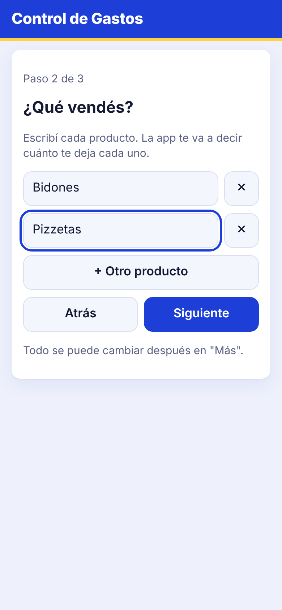

# Control de Gastos

App para el celular que anota los **gastos y ventas** de un emprendimiento chico y muestra
**cuánto deja cada producto**, semana a semana y por mes. Pensada para alguien que no es
programador: se usa con dos o tres toques y no tiene palabras técnicas.

<p>
  
  
  
</p>

**[Ver el video de demostración (1 minuto)](docs/video/control-gastos-demo.mp4)**

## Qué hace

- **Cómo va la semana o el mes:** lo recaudado, lo gastado y lo que te queda.
- **Ganancia por producto:** lo vendido menos lo gastado en cada producto, con el detalle de en
  qué se fue la plata. Los gastos de todo el negocio (como el gas) van aparte, en **General**:
  cuentan en el total pero no se reparten a ojo.
- **Gráfico** de las últimas 8 semanas o los últimos 6 meses: lo que entró contra lo que salió.
- **Cuánto dura cada insumo:** cada vez que abrís un paquete nuevo (harina, un maple de
  huevos…) tocás un botón, y la app calcula cada cuántos días se termina y cuándo te toca comprar.
- **Resumen para WhatsApp** de la semana o el mes, con un toque.
- **Calculadora** para sumar un ticket y pasar el resultado al monto.
- **Funciona sin internet** y se instala como una app desde el navegador.
- **Copia de seguridad** en un archivo, para no perder nada si se rompe o se cambia el celular.

## Para cualquier emprendimiento

No viene atada a ningún negocio. **La primera vez que se abre pregunta** cómo se llama el
emprendimiento, qué vende y en qué gasta (con sugerencias para tocar). Después todo se cambia
desde la misma app, sin tocar código:

| Qué | Dónde | Se puede |
|---|---|---|
| Nombre del emprendimiento | Más → Tu emprendimiento | cambiar o dejar vacío |
| Productos (empanadas, tortas, viandas…) | Más → Productos | agregar, cambiar el nombre, borrar |
| Tipos de gasto (harina, envases, nafta…) | Más → ¿En qué se gasta? | agregar, cambiar el nombre, borrar |
| Insumos (harina 1 kg, maple de huevos…) | Insumos | agregar, cambiar nombre y presentación, borrar |

Lo único fijo es **General**, donde van los gastos de todo el negocio. Lo que ya tiene
movimientos anotados no se borra (para que los totales sigan cerrando), pero se le puede
cambiar el nombre.

**Para pasársela a otra persona:** compartile el link. Cada celular guarda sus propios datos:
nadie ve lo de nadie, y cada uno arranca con su propia bienvenida.

## Cómo empezar

1. **Usarla:** [docs/GUIA.md](docs/GUIA.md) explica cada pantalla con capturas.
2. **Publicarla e instalarla en el celular:** [GUIA-PUBLICACION.md](GUIA-PUBLICACION.md)
   (GitHub Pages, gratis).
3. **Modificarla:** [DESARROLLO.md](DESARROLLO.md) tiene la estructura, el formato de los datos y
   cómo correr las pruebas.

## Privacidad

No hay cuentas, ni servidor, ni nada que se mande a internet: todo lo anotado queda en el
navegador del celular. El único momento en que salen datos es cuando vos compartís el resumen o
guardás una copia.

## Hecha con

HTML, CSS y JavaScript, sin frameworks ni dependencias. El gráfico se dibuja a mano en SVG.
Las pruebas usan `node:test` y Playwright.

```
node --test tests/*.test.js   # cálculos, datos, gráfico y resumen
node tests/e2e.js             # la app entera en un navegador con pantalla de celular
```

## Licencia

[MIT](LICENSE). Usala, copiala y adaptala para tu emprendimiento.
