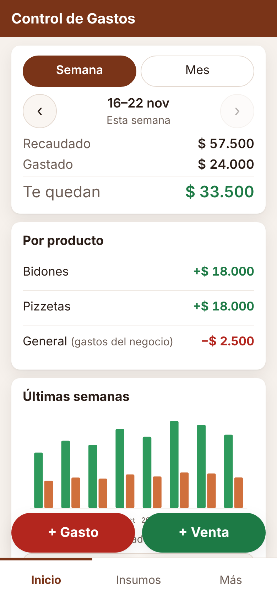

# Control de Gastos

App para el celular que anota los **gastos y ventas** de un emprendimiento chico y muestra
**cuánto deja cada producto**, semana a semana y por mes.

- Recaudado, gastado y ganancia por producto y del total.
- Gráfico de las últimas semanas o meses.
- Cuánto dura cada insumo (harina, huevos, azúcar…) con un solo toque: "Abrí uno nuevo".
- Resumen para mandar por WhatsApp.
- Calculadora a mano.
- Funciona sin internet. Los datos quedan en el celular, con copia de seguridad.

- **Cómo se usa:** [docs/GUIA.md](docs/GUIA.md)
- **Cómo publicarla e instalarla:** [GUIA-PUBLICACION.md](GUIA-PUBLICACION.md)
- **Para programar:** [DESARROLLO.md](DESARROLLO.md)

Sin cuentas, sin servidor y sin dependencias: HTML, CSS y JavaScript.

Licencia MIT.
