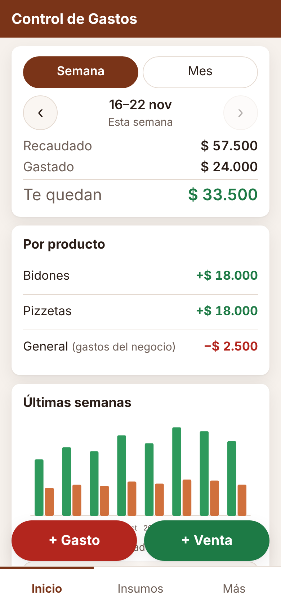
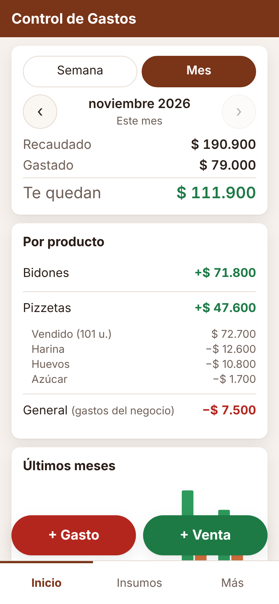
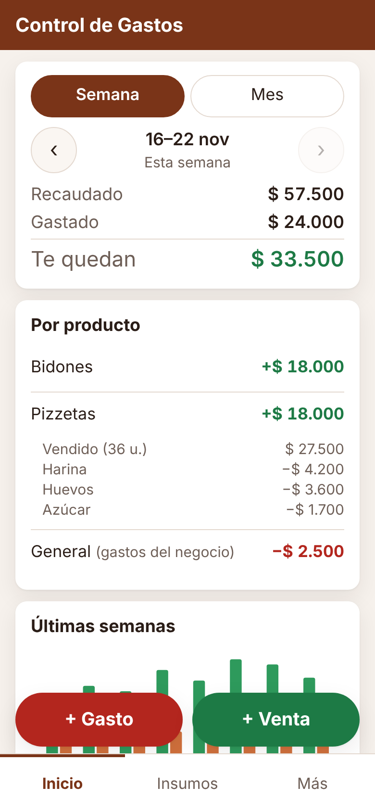
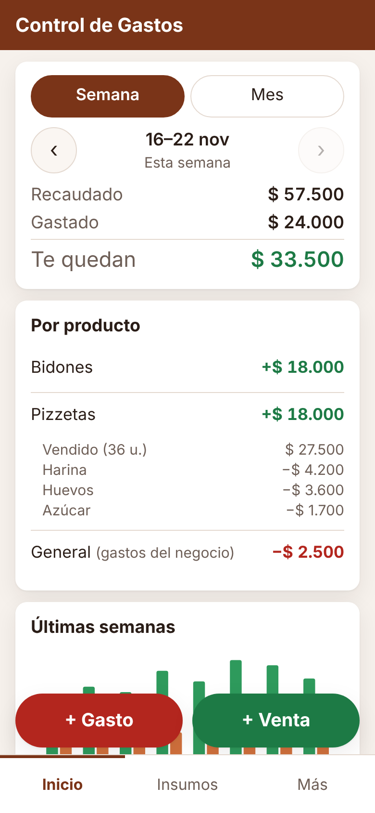
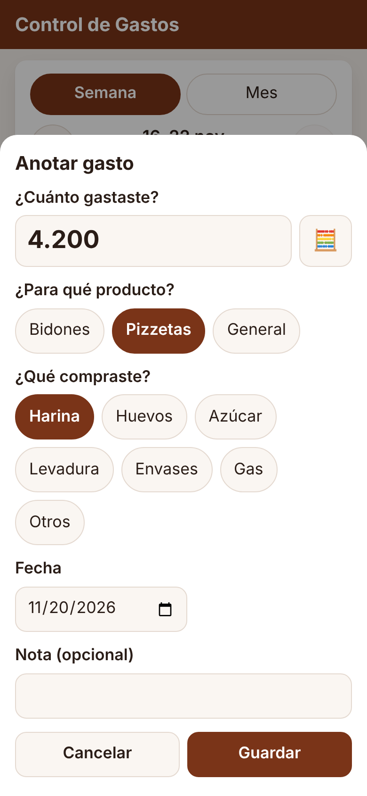
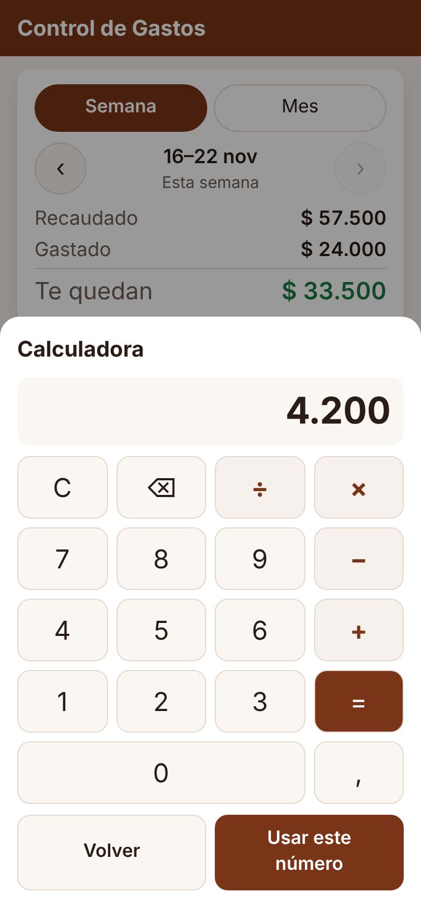
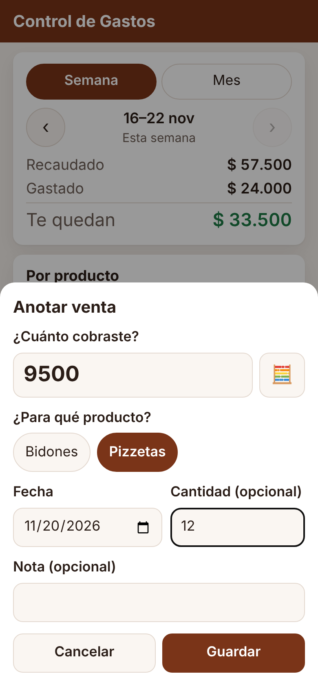
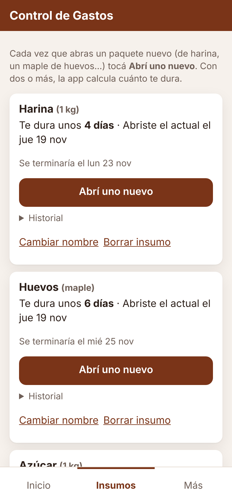
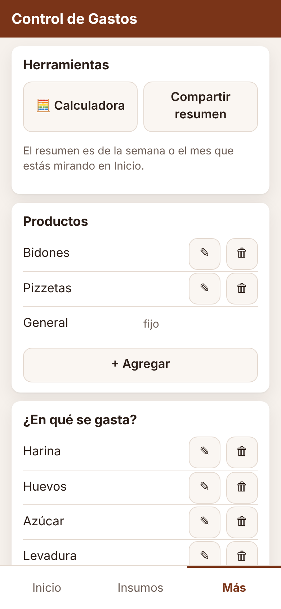
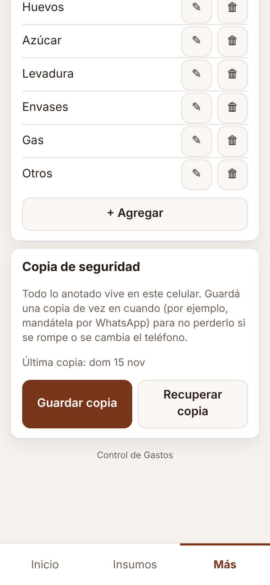

# Cómo usar Control de Gastos

Esta app sirve para anotar lo que gastás y lo que cobrás en el emprendimiento, y ver **cuánto te
deja cada producto**. Todo queda guardado en tu celular: no hace falta cuenta ni internet.

> Los números de las capturas son inventados, de ejemplo.

## 1. La pantalla de Inicio

Al abrir la app ves cómo va **esta semana** (de lunes a domingo):

- **Recaudado**: lo que cobraste.
- **Gastado**: lo que pagaste.
- **Te quedan**: la diferencia. En verde si ganaste, en rojo si gastaste más de lo que entró.

Con las flechas **‹ ›** vas a semanas anteriores. Con **Mes** ves el mes entero.

## 2. Cuánto deja cada producto

En **Por producto** está la ganancia de Bidones y de Pizzetas. Tocá uno para ver en qué se gastó.

**General** son los gastos de todo el negocio (como el gas): cuentan en el total, pero no se le
cargan a ningún producto.

Más abajo, el gráfico compara semana a semana lo que entró (verde) y lo que salió (naranja).

## 3. Anotar un gasto

1. Tocá **+ Gasto** (el botón rojo).
2. Escribí cuánto gastaste. Podés poner los puntos o no: `4200` y `4.200` es lo mismo.
3. Elegí **para qué producto** fue y **qué compraste**.
4. Tocá **Guardar**.

La fecha ya viene con el día de hoy; cambiala solo si anotás algo de otro día.

¿Tenés que sumar varias cosas de un ticket? Tocá el ábaco 🧮 al lado del monto, hacé la cuenta y
tocá **Usar este número**.

## 4. Anotar una venta

Tocá **+ Venta** (el botón verde), escribí cuánto cobraste y de qué producto. La cantidad es
opcional. Podés anotar cada venta o el total del día, como te quede más cómodo.

**¿Te equivocaste?** Tocá el movimiento en la lista de Inicio para cambiarlo o borrarlo.

## 5. Cuánto te dura cada insumo

En **Insumos**, cada vez que abras un paquete nuevo de harina, un maple de huevos, etc., tocá
**Abrí uno nuevo**. Desde la segunda vez, la app te dice cuántos días te dura y cuándo se
terminaría el que estás usando. Si lo tocaste sin querer, aparece **Deshacer** por unos segundos.

## 6. Compartir el resumen

En Inicio (o en **Más**), **Compartir resumen** arma un mensaje con los números de la semana o el
mes que estás mirando, para mandarlo por WhatsApp.

## 7. Agregar productos o tipos de gasto

En **Más** podés agregar un producto nuevo (por ejemplo, empanadas) o un tipo de gasto, y cambiar
nombres. Lo que ya tiene movimientos anotados no se puede borrar, pero sí renombrar.

## 8. Copia de seguridad (importante)

Como todo vive en el celular, si se rompe o lo cambiás se pierde. Una vez por semana tocá
**Guardar copia** en **Más** y mandátela por WhatsApp o guardala en Drive. Si pasa más de un mes
sin copia, la app te lo recuerda.

Para pasar todo a otro celular: instalá la app ahí, entrá a **Más → Recuperar copia** y elegí el
archivo. Ojo: **reemplaza** todo lo que haya en ese celular.

